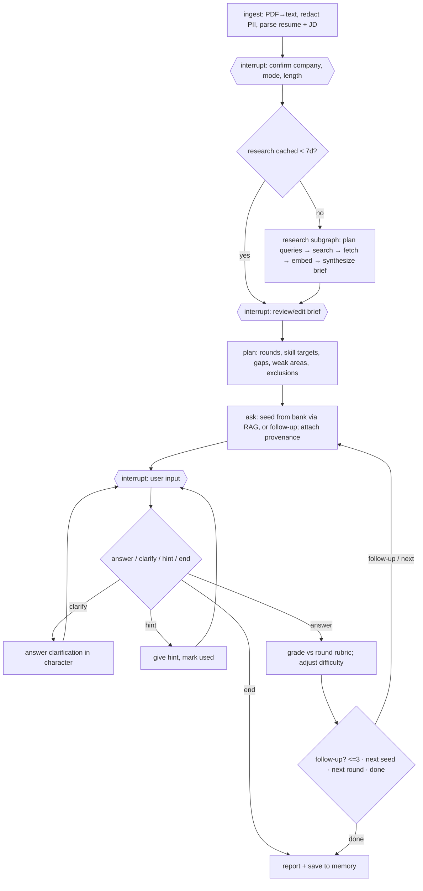

# AI Interview Prep Platform — v1 Spec

Status: **Draft for Product Owner review** · Date: 2026-10-09 · No code written yet.

## 1. Product summary

A candidate uploads a **resume (PDF)** and pastes a **job description**. The agent identifies the company, the
user confirms it, and the agent **researches the company's hiring process and real candidate interview
experiences on the public web**, showing that research live. It then runs an **adaptive mock interview, one
question at a time**. Questions draw on the resume, the role, the research and a curated question bank. The agent
grades each answer against a per-round rubric, asks follow-ups, and ends with a report.

This is a **learning project**. It deliberately exercises RAG, LangChain, LangGraph, LangSmith, and MCP (both
existing and custom servers). It must run on **$0 of paid services**.

## 2. Goals and non-goals

### v1 goals ("done" = all true)
- Full flow works end to end for a real company: upload → confirm company → live research → review brief →
  adaptive graded interview → report.
- Every run is traced in LangSmith; the eval suite passes; unit tests pass with no API quota used.
- Our custom MCP server works from the app **and** from Claude Desktop / Claude Code (documented config).

### Out of scope for v1
Recruiter research (dropped by the PO) · voice answers · code execution · DOCX resumes · JD-by-URL · multi-user/login ·
cloud deployment · PDF export · Prompt Hub · Staff+ seniority · the 4 deferred role tracks (§4).

## 3. Decision log

| Area | Decision |
|---|---|
| Interface | Streamlit multipage: Setup → Research → Interview → Report, plus History |
| Orchestration | LangGraph state machine with human-in-the-loop interrupts |
| LLM | Gemini free tier (`gemini-2.5-flash`) by default; `LLM_PROVIDER=ollama` switches to local `llama3.2` (3B, already downloaded) |
| Embeddings | Always local: Ollama `nomic-embed-text` (already downloaded); no quota used, resume text never leaves the Mac for embedding |
| Vector DB | Chroma on disk; embedding model name stored with each collection so a model change is detected |
| Existing MCP servers | Tavily MCP (search, time-filtered), official Fetch MCP (URL → markdown, respects robots.txt), DuckDuckGo MCP (automatic fallback when Tavily credits run out) |
| Custom MCP server | `interview-prep` server (FastMCP, stdio): question bank, resume, research and session-memory tools (§7) |
| Research sources | Company careers pages + engineering blog; Reddit/forum interview threads; Glassdoor/Blind/Levels.fyi **search snippets only**. No login walls, no scraping of blocked sites |
| Recruiter | **Not researched.** The JD is used for company/role only |
| Research freshness | Prefer the last 2 years; older sources allowed but labelled with their year |
| Conflicting sources | Report consensus plus spread with counts; official company pages outrank anecdotes |
| Thin research | Fall back to typical process for role/industry, clearly labelled |
| Research cache | Per company, 7 days, with a manual Refresh button |
| Company identification | Agent extracts it; **user confirms/edits** before any search credit is spent |
| Brief review | User can edit the brief and add their own notes before the interview starts |
| Rounds | Inferred from research (e.g. screen → technical → system design → behavioral); user may override with a single round |
| Session length | Quick (~5 main questions) or Full (~12 across rounds), plus follow-ups; user can end early and still get a report |
| Follow-ups | Agent decides, **max 3 per main question**, then pulls the next seed from the bank |
| Difficulty | Starting level from JD years + resume seniority; goes up after strong answers, down after weak ones |
| Skill gaps | JD skills missing from the resume are probed (transfer-style questions) and flagged in the report |
| Interaction | Answer (text + code box), ask a clarifying question, ask for a hint (Coaching only; recorded in grade) |
| Feedback mode | User picks per session: **Coaching** (brief score + tip after each answer + end report) or **Mock** (end report only) |
| Rubric | Per round, 1–5 per dimension (§8) |
| Report | In-app + Markdown download |
| Provenance | Collapsible "Why this question?" with sources (resume excerpt, research source, bank ID) |
| Tone | Neutral professional, adapted to company culture from research; never role-plays a real person |
| Memory | Single local user; future sessions avoid questions already answered well and revisit low-scoring topics |
| Resume session | LangGraph SQLite checkpointer; History shows "In progress → Continue" |
| Rate limits | Client-side throttle + auto-retry with visible countdown + "Switch to local model" button |
| PII | Contact info (name, email, phone, address, profile URLs) redacted at parse time, before any LLM call or trace. Original PDF never stored |
| Data deletion | Delete per session + "Delete all my data" (DB rows, vectors, cached research) |
| Developer view | Optional sidebar: current graph node, MCP tool calls (args/results), retrieved chunks + scores, tokens, LangSmith trace link |
| LangSmith | Developer (free) plan: tracing + a ~15-case eval dataset; evals run on demand to save quota |
| Test data | **Synthetic personas only.** The PO's real resume is never used in tests, evals or the repo |
| Tooling | uv + `pyproject.toml` + lockfile, Python 3.12 |
| Deployment | Local only; secrets in `.env` (with `.env.example` committed) so a later deploy stays easy |
| Delivery | One branch + PR per phase; PO reviews and merges; never push to `main` |
| Learning | `docs/learning/phase-N.md` per phase with concepts, code map and 1–2 optional exercises |

## 4. Role tracks

v1 ships three tracks in full depth (question bank, rubric details, eval cases):

| Track | Rounds typically covered |
|---|---|
| Backend SWE | Behavioral, coding concepts, backend/API & DB depth, system design |
| AI/LLM Engineer | Behavioral, LLM fundamentals, RAG/agents/evals design, LLM system design |
| Data Engineer | Behavioral, SQL, pipelines/orchestration, data modeling, data system design |

Deferred to a later phase as **data-only additions** (no code changes): Full-stack, Frontend, Generalist SWE,
Data Analyst. Seniority range: new grad → senior. System design is light or skipped for new grads.

## 5. User flow

1. **Setup**: upload resume PDF, paste JD. Choose Coaching/Mock and Quick/Full. Agent parses both and shows the
   redacted profile, detected company, track and seniority. **User confirms or edits the company.**
2. **Research**: live activity panel streams each step ("Searching: … (Tavily)", "Reading: … (Fetch)", "Tavily
   out of credits → DuckDuckGo"). Ends with a cited brief: process and rounds (consensus + counts), common topics,
   culture/tone, sources with years, confidence. **User edits it or adds notes**, optionally overrides rounds,
   then clicks Start. Cached briefs (< 7 days) load instantly, with a Refresh button.
3. **Interview**: one question at a time in a chat layout, with a code box for snippets. Buttons: Answer, Clarify,
   Hint (Coaching only), End interview. Coaching shows a short graded tip after each answer. Each question has a
   collapsible "Why this question?".
4. **Report**: scores per round and dimension, strengths, JD gaps, best/weakest answers with improved versions,
   and a study plan. Download as Markdown.
5. **History**: past and in-progress sessions (Continue / View report / Delete), plus "Delete all my data".

## 6. Architecture

```
Streamlit UI ──▶ LangGraph app (checkpointed in SQLite)
                   │  LLM: Gemini ⇄ Ollama llama3.2 (init_chat_model + rate limiter + retry)
                   │  Embeddings: Ollama nomic-embed-text
                   ▼
            langchain-mcp-adapters (MultiServerMCPClient)
     ┌──────────────┬──────────────┬─────────────────┬──────────────────────────┐
  Tavily MCP     Fetch MCP     DuckDuckGo MCP     interview-prep MCP (ours)
  (npx)          (uvx)         (uvx, fallback)    (FastMCP, stdio) ──▶ SQLite + Chroma
                                                                         (.data/, gitignored)
LangSmith ◀── traces from every LLM call, graph node and tool call
```

### LangGraph flow



### Repository layout (target)

```
pyproject.toml  uv.lock  .env.example
src/interview_prep/
  config.py            settings (pydantic-settings)
  llm.py               provider switch, rate limiter, retry
  schemas.py           Pydantic models (ResumeProfile, ParsedJD, ResearchBrief, Question, Grade, Report …)
  ingest/              pdf.py, redact.py, resume.py, jd.py
  research/            subgraph, query planning, synthesis, fallback
  graph/               state.py, nodes/, build.py
  embeddings.py        Ollama embeddings (nomic task prefixes)
  question_bank.py     load/validate the bank, fingerprint for re-indexing
  storage/             db.py (SQLite + migrations), vectors.py (Chroma)
  mcp_server/          our interview-prep MCP server (`uv run interview-prep-mcp`)
  mcp_client.py        MCP server registry + lifecycle
app/                   Home.py + pages/ (Setup, Research, Interview, Report, History, Question bank test page)
data/question_bank/    shared.json (screen + behavioral), backend_swe.json, ai_llm_engineer.json, data_engineer.json
tests/                 pytest, fake chat models, no network
evals/                 synthetic personas + LangSmith eval runner
docs/                  SPEC.md, learning/phase-N.md, mcp-clients.md
playground/            gitignored scratch experiments
```

## 7. Custom MCP server — `interview-prep`

It owns all **stateful data and retrieval**. LLM reasoning stays in the graph, so the server needs no model keys.

| Tool | Purpose |
|---|---|
| `extract_resume_text(pdf_path)` | PDF → text with contact info redacted (deterministic) |
| `search_question_bank(query, track, round, difficulty, exclude_ids, k)` | RAG over the curated bank |
| `index_resume(session_id, text)` / `search_resume(session_id, query, k)` | Resume chunks for personalization and provenance |
| `get_cached_research(company)` / `save_research(company, brief, chunks)` / `search_research(company, query, k)` | Research cache + RAG over fetched pages |
| `get_weak_areas(track)` / `get_answered_questions(track)` | Memory for planning |
| `save_turn(...)` / `save_report(...)` / `list_sessions()` / `get_report(session_id)` | Session persistence |
| `delete_session(session_id)` / `delete_all_data()` | Data deletion |

Built so far (Phase 2): `search_question_bank`, `get_question` (added), the `question-bank://{track}` resource
(added), `extract_resume_text`, `index_resume`, `search_resume`, `delete_session` and `delete_all_data(confirm)`.
Research tools arrive in Phase 3, and memory and session tools in Phase 5, once their schemas exist.

`docs/mcp-clients.md` will document how to connect it to Claude Desktop and Claude Code (for example, "find
Kafka questions in my bank" or "what are my weak areas?").

## 8. Rubrics (1–5 per dimension)

| Round | Dimensions |
|---|---|
| Behavioral | Situation/Task clarity, Actions (own contribution), Result/impact (measurable), Reflection |
| Technical / coding concepts | Correctness, Depth, Trade-offs, Communication |
| System design | Requirements, Architecture, Scaling & reliability, Trade-offs |
| Screen / HR | Motivation & fit, Clarity, Role understanding |

Each grade records: dimension scores, a one-line tip, whether a hint was used, and a suggested better answer
(shown in Coaching, or in the report for Mock).

## 9. Question bank

About 30 behavioral questions shared across tracks, plus about 25 per track. Questions are LLM-drafted, **reviewed
by the PO in the Phase 2 PR**, and versioned in git. Each entry has: `id, track, round, topic tags, difficulty,
question, what_good_looks_like`. Seeds are retrieved by RAG, filtered by track/round/difficulty, and exclude
questions already answered well.

## 10. Free-tier budget ($0)

| Service | Free allowance (verify at build time) | Our usage |
|---|---|---|
| Gemini API | ~10–15 requests/min; daily cap varies by model | Quick session ≈ 35 calls, Full ≈ 80. Throttled client-side |
| Tavily | 1,000 credits/month; basic search = 1 credit | ≈ 10 credits per fresh company research → ~100/month; cache cuts repeats |
| LangSmith Developer | 1 seat, ~5k traces/month, 14-day retention, datasets + evals included | Tracing + on-demand evals |
| Ollama / Fetch / DuckDuckGo | Free, local or no key | Embeddings, fallback LLM, fetching, fallback search |

The PO accepted Gemini free-tier data terms, given that redaction happens first.

## 11. Testing and evaluation

- **Unit tests (pytest, no network):** PII redaction, PDF/JD parsing with fake chat models, graph routing
  (follow-up cap, hint only in Coaching, end-early → report), MCP tools against a temp DB, cache expiry, provider switch.
- **LangSmith evals (~15 synthetic persona cases across the 3 tracks):**
  - *Question relevance*: LLM-as-judge checks that each question ties to a resume item or a JD skill.
  - *PII leak*: deterministic check that no contact info appears in any prompt.
  - *Grading consistency*: a strong answer outscores a weak one, and re-grading stays within ±1.
  - *Follow-up appropriateness*: vague answers trigger follow-ups; strong ones move on.

## 12. Delivery plan (each phase = 1 PR, runnable, with `docs/learning/phase-N.md`)

| Phase | Scope | Runnable result |
|---|---|---|
| **1. Foundation + cleanup** | Untrack `venv/` and `.DS_Store`; drop `stash@{0}`; move experiments to `playground/`; unstage the resume PDF; uv/pyproject; config; LLM provider switch + throttle/retry; PII redaction; resume + JD parsing; Setup page | Upload resume + JD → see redacted profile, company, track |
| **2. Custom MCP + RAG** | `interview-prep` MCP server, SQLite schema, Chroma + nomic, question bank (PO review), Claude Desktop/Code docs | Query the bank from Claude Desktop and from a test page |
| **3. Research agent** | Tavily/Fetch/DuckDuckGo via MCP adapters, research subgraph, cache, live activity panel, editable brief | Real company → live research → cited brief |
| **4. Interview loop** | LangGraph graph, interrupts, SQLite checkpointing, clarify/hint/follow-up routing, difficulty adaptation, Developer view | Full adaptive interview, resumable |
| **5. Grading, report, memory** | Rubrics, Coaching/Mock, report + Markdown download, History, weak-area memory, deletion | v1 feature-complete |
| **6. Evals + polish** | Synthetic personas, LangSmith dataset + evaluators, README + architecture diagram | v1 "done" bar met |

## 13. Risks and mitigations

| Risk | Mitigation |
|---|---|
| Streamlit reruns the whole script on each interaction; the MCP client and LangGraph are async | Persistent background event loop + MCP sessions held in `st.cache_resource`; state lives in the LangGraph checkpointer, not `st.session_state`. Spike this first in Phase 3 |
| Gemini free-tier limits change or tighten | Throttle, retry, cache research, Ollama switch |
| Review sites block fetching | Use search snippets; Fetch respects robots.txt; brief shows confidence |
| 3B local model grades poorly | Labelled "local fallback — lower quality" in the UI; evals compare providers |
| Hallucinated research | Every claim in the brief is cited; user reviews and edits before the interview |
| Synthetic eval data doesn't match real resumes | Diverse personas across tracks and seniority levels; PO can spot-check locally with their own resume |
| Redaction misses PII | Regex + LLM-free heuristics, unit-tested; PII-leak eval on every eval run |

## 14. Open items for PO review

1. Confirm the three v1 tracks and the bank size (~30 behavioral + ~25 per track).
2. Confirm session sizes: Quick ≈ 5 main questions, Full ≈ 12.
3. Anything in §3 you want to change before Phase 1 starts.
